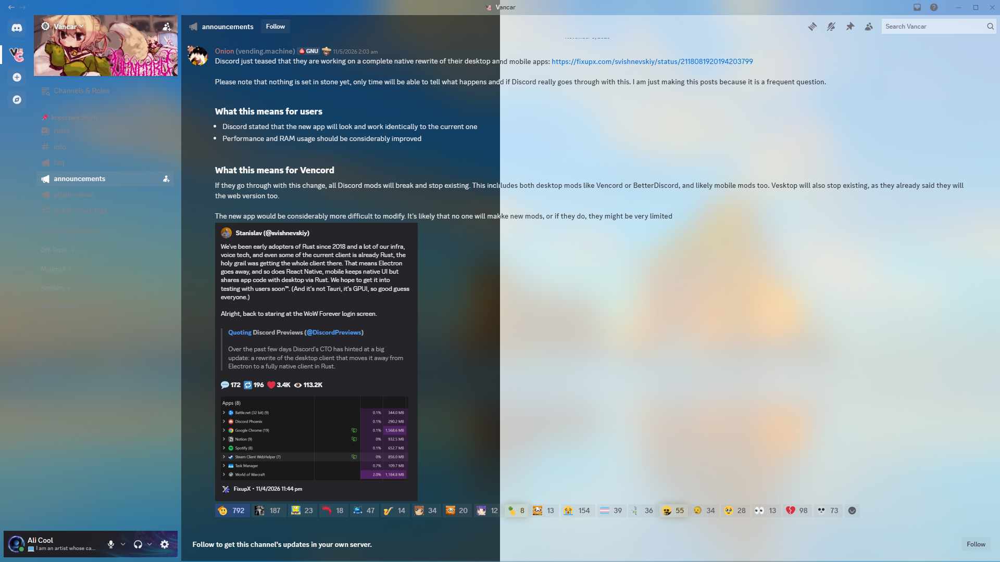

# Discord Acrylic
Theme for Vencord to enable Acrylic Backdrop.



## To Enable Transparency
### Requirements
[BetterDiscord](https://betterdiscord.app/) with [MicaForEveryone](https://github.com/MicaForEveryone/MicaForEveryone) or [Vencord](https://vencord.dev/).

### BetterDiscord
1. Add `discord.exe` process to MicaForEveryone and set backdrop type to "Acrylic" (or any that you'd like).
2. Enable transparency in BetterDiscord settings.

### Vencord
1. Select "Acrylic" background material (or any that you'd like) at the very bottom of Vencord settings.
2. Relaunch Discord.

## To Apply Theme
### Local File
1. Download [`acrylic-discord.css`](https://github.com/AliCool412/Discord-Acrylic/blob/main/acrylic-discord.css) and copy/move it to your BetterDiscord/Vencord theme folder.
2. Enable it from your respective theme settings.

### QuickCSS
1. Go to  [`acrylic-discord.css`](https://github.com/AliCool412/Discord-Acrylic/blob/main/acrylic-discord.css).
2. Copy raw file.
3. Paste it in your QuickCSS editor.

### Online Themes
Paste the following into the theme URLs section :

```
https://raw.githubusercontent.com/AliCool412/Discord-Acrylic/main/acrylic-discord.css
```
